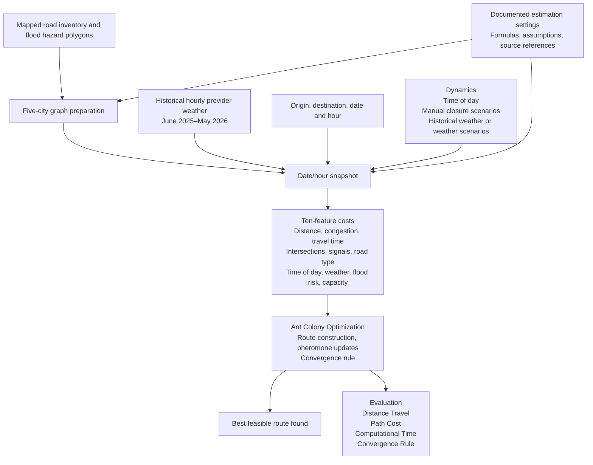

# ANTROUTE: ACO System Architecture

Download the architecture diagram: [PNG](aco_system_architecture.png) | [JPG](aco_system_architecture.jpg). Both exports use a monochrome academic flowchart layout at 3600 × 4500 pixels and reflect the implemented codebase. Regenerate them with `python scripts/render_architecture.py` from `traffic_system`.

Scope: San Juan, Manila, Mandaluyong, Makati, and Pasig. Period: **June 1, 2025–May 31, 2026**, hourly. The user permits documented estimates. The release is a historical-period routing model, not a fully observed traffic archive.

## Inputs and methods

Distance and intersections are calculated from mapped geometry/topology. Road classifications and signals come from OSM, with missing signals assumed absent and labeled. The September 2026 map is a static temporal surrogate. Flood risk is mapped NOAH hazard exposure, not observed hourly flooding.

Traffic congestion and travel time use the published BPR functional form with explicitly assumed hourly demand and weekend/road-type factors. Capacity uses a reference saturation flow and assumed signal green ratio; lane fallbacks are disclosed. Historical provider weather is mapped to city grids; rain-speed effects use transferred FHWA reference ranges. The time-of-day feature uses the exact timestamp hour with a separate assumed peak-hours cost policy.

Every feature's source, classification, formula, and assumptions are documented in [estimation_methods.md](estimation_methods.md), the configuration, generated registry, and app. Feature weights come from CRITIC over a year-wide sample of segment-hours; normalization references are provisional objective settings. No TomTom or HERE dependency is introduced.

## Algorithms

| | Proposed: ANTROUTE | Baseline: Cheng (2023) |
|---|---|---|
| Module | `aco_routing.py` | `baseline_cheng.py` |
| Factors | ten features | path length, travel time, traffic flow (estimated) |
| Weights | CRITIC | AHP from the paper (0.637, 0.258, 0.105) |
| Search | ACO, destination-distance heuristic, convergence rule | eq. 8 heuristic, q0 transfer rule, local/global updates, fixed NC_max |
| On a change during a trip | when a road's cost changed by ≥10% or a road closed/reopened: re-search from the current node with fresh pheromone | eq. 9 as printed on roads whose travel time changed, full re-search with the rescaled pheromone |

`/routes/plan` and `/routes/baseline` route one date/hour snapshot. `/routes/trip` (`dynamic_trip.py`) simulates a trip: it drives the planned route, checks conditions on arrival at each node (the hour follows the trip clock; scheduled events close or reopen roads or change the weather), and applies the algorithm's dynamic rule. Every driven road is scored with the ten-feature cost and travel time of the moment it is entered. A trip reports initial routing time (graph build and search at departure), dynamic re-routing time (graph rebuild, change handling and re-search per re-route), computational time (both plus condition checks that did not lead to a re-route), and convergence rate as iterations to convergence (the iteration at which a search first found its final best route). `scripts/evaluate_sop.py` runs both algorithms on the same trips, events and seeds and answers SOP 1–3.

A pheromone-carry-over variant (CSPA: scaling the pheromone of changed roads by old/new cost and keeping the rest) was evaluated and removed: on the same trips it gave higher path cost than re-planning with fresh pheromone in every scenario, because the retained pheromone kept the colony near the pre-change route. Adaptations of the baseline to this network are listed in `baseline_cheng.py`; the results reproduce Cheng's mechanisms on this network, not the paper's original experiments.

## Execution

1. Verify the release artifacts and authorized period/mode.
2. Validate endpoints and the selected date/hour.
3. Load provider weather for that timestamp, or apply the explicitly selected weather scenario.
4. Resolve modeled traffic from hour, weekday, and road type. Exclude manually closed segments.
5. Normalize the ten feature contributions and form segment costs.
6. Run ACO using pheromones, cost and destination-distance heuristics, cycle avoidance, and bounded backtracking. No separate shortest-path solver supplies the route.
7. Display the best feasible route found, four evaluations, and input provenance. Changed inputs clear the old result until recalculation.

Routes remain within the five-city union. Each run uses one consistent snapshot. Historical weather records vary by date; modeled traffic is not represented as independent observed hourly samples. Static road/flood features are held constant by assumption.

## Evaluation

Distance Travel sums segment lengths. Path Cost sums the configured feature costs. Computational Time covers graph preparation and ACO, excluding input acquisition and rendering. Convergence Rule requires relative best-cost improvement within tolerance for the configured consecutive iterations after a feasible route exists; iteration-limit stops are reported separately. Convergence does not prove global optimality.

Functional tests and a demand-assumption sensitivity report verify behavior, not the empirical accuracy of the estimated historical conditions.
